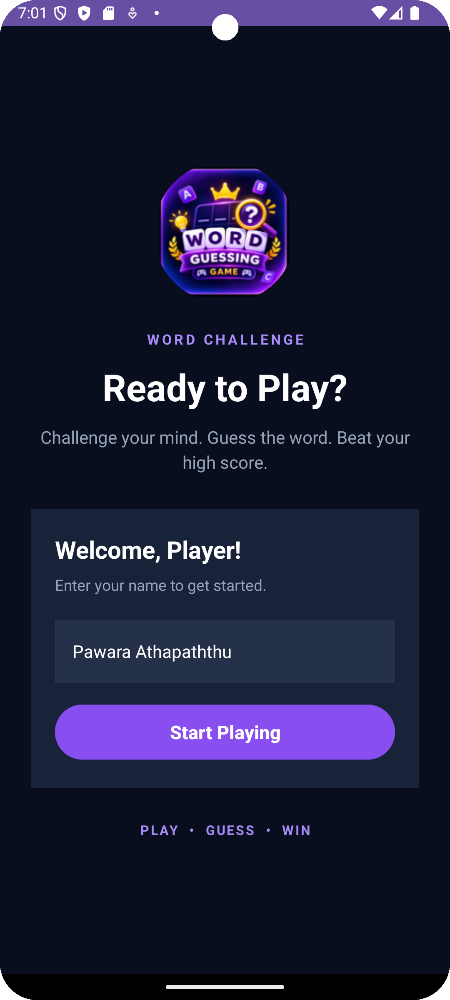
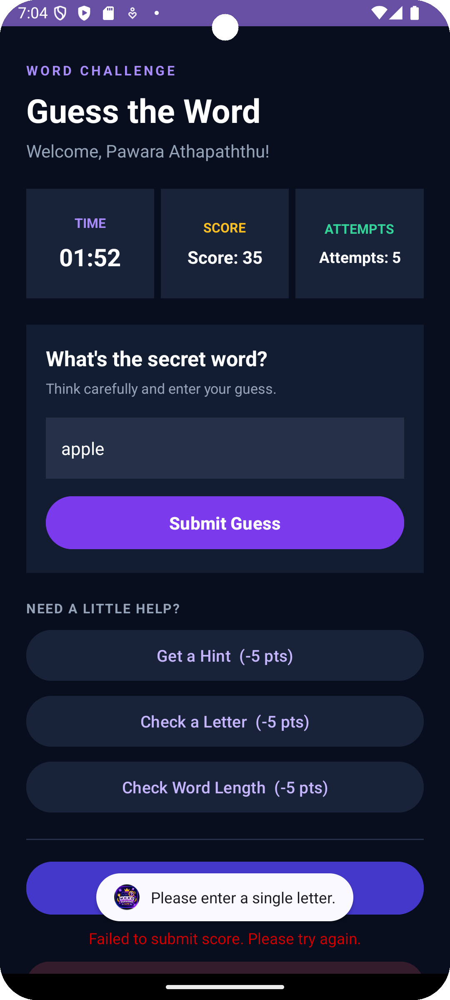

\# WordQuest – Android Word Guessing Game

WordQuest is an Android word guessing game designed to improve vocabulary and problem-solving skills through interactive gameplay.

\## Features

\- Interactive word guessing gameplay

\- Welcome and onboarding screen

\- Score tracking

\- Leaderboard

\- User-friendly interface

\## Technologies Used

\- Kotlin

\- XML

\- Android Studio

\- Android SDK

\- Gradle

\## App Screenshots

| App Preview | Welcome Screen | Home Screen | Gameplay |

|:---:|:---:|:---:|:---:|

|  |  |  |  |

\## Getting Started

1\. Clone this repository.

2\. Open the project in Android Studio.

3\. Sync Gradle dependencies.

4\. Run the application on an Android emulator or physical device.

\## Project Purpose

This project was developed to demonstrate Android mobile application development, UI design, and game logic implementation.

\## Developer

Pawara Athapaththu

