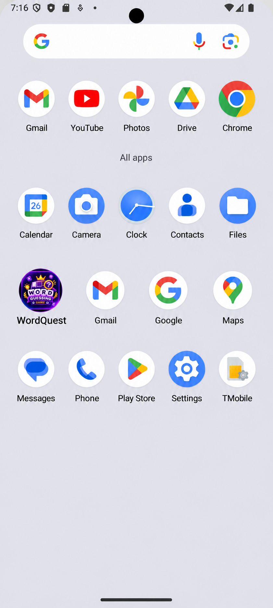
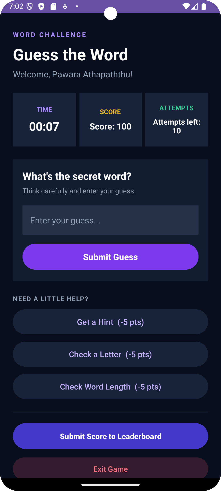

\# WordQuest - Android Word Guessing Game

WordQuest is an interactive Android game designed to improve vocabulary and problem-solving skills.

\## Features

\- Interactive word guessing gameplay

\- Score tracking and countdown timer

\- Hint system

\- Limited guessing attempts

\- Leaderboard feature

\- Modern user interface

\## Technologies Used

\- Kotlin

\- XML

\- Android Studio

\- Android SDK

\- Gradle

\## App Screenshots

| App Preview | Welcome | Home | Gameplay |

| :---: | :---: | :---: | :---: |

|  |  |  |  |

\*App icon preview is an edited promotional image.\*

\## Getting Started

1\. Clone this repository.

2\. Open the project in Android Studio.

3\. Sync Gradle dependencies.

4\. Run on an emulator or Android device.

\## Developer

Pawara Athapaththu

